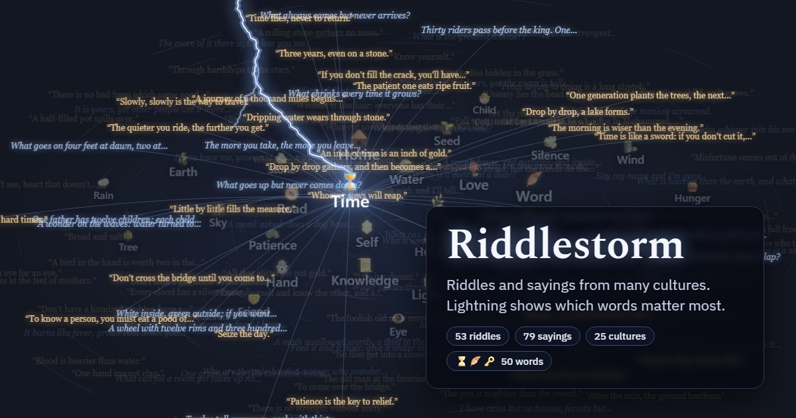

# Riddlestorm

**Live:** https://riddlestorm.julietous.workers.dev/ · part of [my web apps](https://apps.julietous.workers.dev/)

A storm of riddles and sayings from many cultures. Lightning lights up the words they keep returning to, so you can see which words carry the most symbolic weight, and what that weight could mean for ideas and business.

- **Storm** (canvas): riddles (blue, italic) and sayings (gold) orbit the eye of the storm, with the 32 heaviest words (20 on phones). Every few seconds lightning strikes a heavy word and threads light up to every riddle that uses it. Hover a riddle to read it, click to reveal the answer, click a word for its mind map.
- **Mind map** (drawer): what the word evokes, business opportunities, linked words and the cultures that use it.
- **Word atlas**: all 50 words, ranked by `weight = uses + 2 × cultures + ½ × links` (scaled to 100), searchable by word, feeling or market.
- **Symbols**: every word has a thematic emoji (hourglass for time, quill for word, hamsa for hand), tinted gold in the storm and in full colour when lightning lights it up. Where a traditional sign exists (ankh, alchemical elements, planet signs) the word's page shows it too, drawn with Google's Noto symbol fonts.
- **Five languages**: Swahili, Chinese, Russian, Arabic and Spanish riddles and sayings, in the original script, with their meanings. Each card shows four and folds out the rest.
- Opens with a short (~1.3 s) intro: riddle words spiral in, lightning, title. Skip with the button, a click or Esc. Shorter and calmer with reduced motion.

## Tests

Playwright tests in TypeScript: `npm install`, then `npm test` (serves `site/` with the tiny Node server in `scripts/serve.mjs`). Google Fonts are blocked in the tests, so they never depend on the network and prove the page works with fallback fonts.

- `tests/data/`: the dataset in `site/data.js`: size (50+ words, 50+ riddles, 60+ sayings), every meaning is a known word, no duplicates, every word has its own symbol, 4 associations and 3 opportunities and is used at least twice, and Arabic, Persian and Hebrew originals are right-to-left.
- `tests/ui/`: the intro (short, Skip, reduced motion, starts at the top), the storm (drawn, heaviest words shown, lightning caption, clicking a word on the canvas, hovering and pinning a riddle, a pinned riddle closing on resize, the shade behind the intro text, frame cost under 4 ms), the mind-map drawer (symbol, sign, branches, linked words by mouse and keyboard, opaque background, Escape and focus), the word atlas (ranking, search, one-line stats), the five language cards (script, `lang` and `dir`, fold-out), the header bar below the storm, no horizontal scrolling, and axe scans. Runs on desktop Chrome and a Pixel 7.

43 tests. In v3 they found three issues, all fixed: the intro animation could stop on its first frame (the frame time could be slightly before the start time, which gave a negative radius), the mind map was marked as an image although its linked words are buttons (axe `nested-interactive`), and a manual strike did not restart the timer for the next automatic one.

## Structure

- `site/index.html`, `style.css`, `app.js`: the page, storm canvas, drawer and sections
- `site/data.js`: riddles, sayings, meanings, symbols and languages
- `scripts/og.mjs`: renders the 1200×630 share banner from the running site
- `scripts/serve.mjs`: a minimal static server for the tests
- `tests/`: the Playwright suite

All data is in `site/data.js`; add riddles or sayings there and tag them with meaning ids. Static site, no build step.

Run locally: `npm run serve` (port 8132), or `python -m http.server 8131 --directory site` (launch config "riddlestorm").
Deploy: `npx wrangler deploy` from `apps/riddlestorm`.

## Credits

Riddle and saying texts are short retellings of traditional sources (named per item in the app). Fonts: IBM Plex Sans, Spectral and Noto Sans Symbols via Google Fonts.

## Versions

- **v4** (23 Nov 2026): a polish release. The intro text sits on a soft shade so drifting riddles no longer run through it; the header gets a solid bar below the storm; the atlas puts each word's stats on one line of their own; language cards show four texts with a "Show more" button (the page on a phone is about 30% shorter); the word drawer is opaque; linked words in the mind map show keyboard focus; a pinned riddle closes when the window is resized instead of floating at a stale spot. 43 Playwright tests (was 35); the tests now wait for DOMContentLoaded and read the intro length from the page, so they hold up on a busy machine.
- **v3** (17 Nov 2026): 35 Playwright tests; fixes for the intro animation, the mind map's accessibility and the strike timer.
- **v2** (17 Nov 2026): 50 words (was 25), 79 sayings (was 15) and 53 riddles from 25 cultures; an emoji symbol for every word; searchable word atlas; a 1.5 s intro (was 4 s); faster drawing (text, emoji and glows are cached as small images, so a frame costs under 1 ms of script time).
- **v1** (17 Nov 2026): first release.
